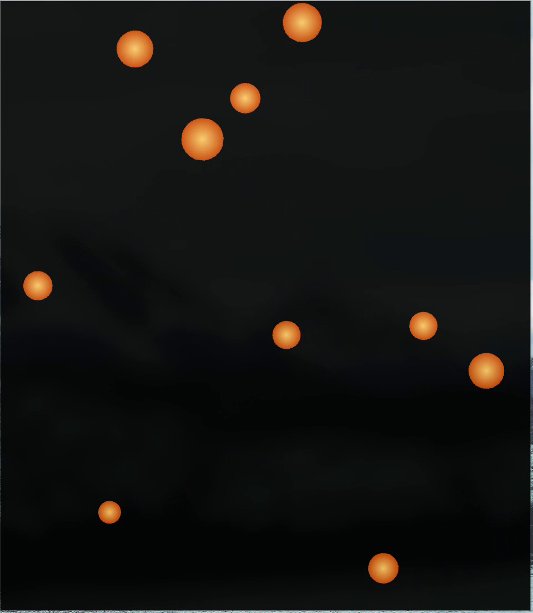

# Bouncing Balls — Guide

A small LÖVE (Love2D) demo where balls bounce around the window, collide with
each other, throw off sparks, and play a procedurally generated impact sound.
There are no image or audio assets to fetch beyond the ball texture — the
collision response, particles, and sound are all implemented in Lua. Watch the demo 

## Running

From the repository root:

    love bouncing_balls/

Or from inside this folder:

    cd bouncing_balls
    love .

You can choose how many balls to start with by passing a number after the
game path:

    love bouncing_balls/ 25

- Default: **10 balls**
- Valid range: **1–100** (`MAX_BALLS` in `main.lua`)
- Anything that isn't a whole number in that range is ignored and the default
  of 10 is used.

## Controls

| Input | Action |
| ----- | ------ |
| `R`   | Restart the game with a fresh random layout |
| Close window | Quit |

Each ball gets a random position, radius (20–40 px), and velocity
(−100 to 100 px/s) at startup, so every restart looks different.

## Project layout

    bouncing_balls/
    ├── assets/
    │   └── ball.png        # source texture for the balls
    ├── conf.lua            # window setup and module toggles
    ├── main.lua            # entry point, game loop, spawning, collisions
    └── src/
        ├── ball.lua        # ball state, movement, collision, drawing
        ├── vector.lua      # small 2D vector helper
        ├── spark.lua       # particle burst system
        ├── sound.lua       # procedural impact sound
        └── textures.lua    # turns the image into a circular sprite

## How it works

### Window and configuration (`conf.lua`)

The window is 800×600, resizable, and vsync-enabled. The `physics`,
`joystick`, and `touch` modules are disabled because the demo implements its
own simple physics and only needs the keyboard.

### Game loop (`main.lua`)

- `love.load` sets up the sound pool, loads the ball texture, clears any
  particles, and spawns the balls.
- `love.update` advances every ball, checks every pair of balls for a
  collision, emits sparks and sound on impact, then updates the particles.
- `love.draw` draws all balls first, then the sparks on top.

Collision checks are pairwise (`O(n²)`), which is fine for up to 100 balls.
Only pairs that are actually overlapping *and* moving toward each other
produce a response.

### Ball physics (`src/ball.lua`)

- Position is integrated with `position += velocity * dt`.
- Each ball also has a random `rotation` and `spin`, so the texture visibly
  rotates as it moves.
- `Ball:bounce` reflects the velocity when the ball reaches a window edge and
  clamps the position so it cannot escape — this also handles window resizing.
- `Ball:collide` does an impulse-based, perfectly elastic collision
  (`ELASTICITY = 1.0`):
  - Computes the collision normal and relative velocity.
  - Ignores pairs already moving apart.
  - Separates overlapping balls proportionally to their inverse mass.
  - Applies an impulse along the normal.
  - Mass is `radius²`, so larger balls are harder to push around.
  - Returns the contact point, normal, and impact strength for effects.

### Particles (`src/spark.lua`)

On impact, a burst of short-lived line sparks is emitted at the contact point,
spraying away from the collision normal. Sparks have random speed and lifetime,
are slowed by drag, fade out as they age, and are capped at **400** live
particles. They are drawn with additive-looking warm colors (transparency
fading as they die).

### Sound (`src/sound.lua`)

The impact sound is synthesized at load time — no audio files involved:

- 80 ms of decaying noise plus a 100 Hz sine tone.
- A pool of **8** static sources is rotated so overlapping hits don't cut each
  other off.
- A **25 ms** cooldown prevents machine-gun stacking when many balls collide.
- Volume scales with impact strength and each playback gets a random pitch
  between 0.8× and 1.3× for variety.

### Circular texture (`src/textures.lua`)

`assets/ball.png` is loaded and drawn into a 64×64 canvas using a stencil
circle, so the sprite is perfectly round no matter what the source image's
edges look like. The resulting canvas is used for every ball.

## Tuning the demo

Most of the interesting knobs are plain constants near the top of their files:

| File | Constant | Effect |
| ---- | -------- | ------ |
| `main.lua` | `MAX_BALLS` | Upper limit for the command-line ball count |
| `main.lua` | `ballsQuantity = 10` | Default ball count |
| `ball.lua` | `ELASTICITY` | `1.0` = perfectly bouncy; lower for energy loss |
| `spark.lua` | `MAX_SPARKS` | Particle cap (performance vs. richness) |
| `spark.lua` | `DRAG` | How quickly sparks slow down |
| `sound.lua` | `POOL_SIZE` | How many impact sounds can overlap |
| `sound.lua` | `COOLDOWN` | Minimum time between impact sounds |
| `textures.lua` | `SIZE` | Resolution of the generated circular sprite |

Spawn ranges (radius, velocity) live directly in `love.load` in `main.lua`.

## Requirements

- [LÖVE 11.5+](https://love2d.org)
- Arch Linux: `sudo pacman -S love`
